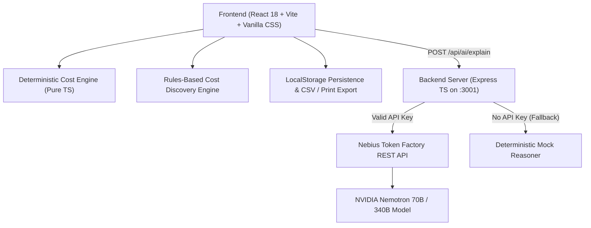

# VeraCost — Transparent Total Cost Decision Platform

[](LICENSE)
[](https://build.nvidia.com)
[](https://tokenfactory.nebius.com)
[]()

> **"Look beyond sticker prices. Model the true lifecycle cost of ownership, repairs, consumables, and replacement over time."**

---

## 1. Overview & Core Value Proposition

Purchasers frequently fall into the **"Sticker Price Trap"**: choosing products with lower upfront purchase prices while ignoring massive ongoing expenses such as proprietary consumables, high-rate recurring subscriptions, mandatory adapters, battery degradation, and accelerated depreciation.

**VeraCost** is a professional decision-support and simulation platform designed to evaluate Total Cost of Ownership (TCO). It combines:
1. **Deterministic Calculation Engine**: Strict mathematical normalization of multi-frequency billing (daily, weekly, monthly, quarterly, annual), equipment longevity replacement milestones, and residual resale recovery.
2. **Rules-Based Cost Discovery**: Proactively detects commonly overlooked domain expenses (dongles, AppleCare, water filters, high-torque EV tire wear, cloud egress fees).
3. **Data Provenance & Audit Trail**: Explicitly tags assumptions (`confirmed`, `user-estimate`, `external-source`, `suggested-unverified`, `missing`) so users always know where verified data ends and estimates begin.
4. **NVIDIA Nemotron via Nebius Token Factory**: Server-side AI intelligence that analyzes tradeoffs, flags missing assumptions, stress-tests scenarios, and provides plain-language executive summaries without ever hallucinating or altering mathematical results.

---

## 2. Hackathon & Event Readiness

| Hackathon Requirement | VeraCost Implementation |
| :--- | :--- |
| **Model Eligibility** | Uses official open-source **NVIDIA Nemotron** models: `nvidia/Llama-3.1-Nemotron-70B-Instruct-HF` (primary default), `nvidia/nemotron-4-340b-instruct`, or `nvidia/nemotron-3-ultra-550b-a55b`. |
| **Provider Compliance** | Inference is executed through **Nebius Token Factory** (`https://api.tokenfactory.us-central1.nebius.com/v1` or `https://api.studio.nebius.ai/v1`) using OpenAI-compatible REST endpoints. |
| **Secret Management** | Zero client-side API key exposure. Keys are stored exclusively in server environment variables or isolated session headers. |
| **Mock Development Mode** | Includes a high-fidelity, deterministic fallback reasoning engine explicitly labelled: `[SIMULATED DATA - MOCK MODE ACTIVE]`. Judges can test without providing a private key! |
| **Live Credential Testing** | In-app settings modal with live connection test button to verify Nebius credentials without restarting. |
| **Open Source License** | Apache License 2.0 included in [LICENSE](LICENSE). |

---

## 3. System Architecture



---

## 4. Quickstart Guide (Running Locally)

### Prerequisites
- **Node.js**: v18.x or higher (tested on Node v24)
- **npm**: v9.x or higher

### Installation

```bash
# 1. Clone repository
git clone https://github.com/your-username/veracost.git
cd veracost

# 2. Install dependencies
npm install

# 3. Configure environment
cp .env.example .env
```

### Configuration (`.env`)

Edit `.env` to provide your Nebius Token Factory API key:

```env
PORT=3001
NEBIUS_API_KEY=your_actual_nebius_api_key_here
NEBIUS_BASE_URL=https://api.tokenfactory.us-central1.nebius.com/v1
NEBIUS_MODEL=nvidia/Llama-3.1-Nemotron-70B-Instruct-HF
```

> **Note**: If `NEBIUS_API_KEY` is left blank, VeraCost will automatically run in **Mock Development Mode**, allowing full UI and calculation testing.

### Launching the Application

Run server and frontend concurrently with a single command:

```bash
npm run dev
```

- **Frontend Client**: `http://localhost:5173`
- **Backend API**: `http://localhost:3001`
- **Health Check**: `http://localhost:3001/api/health`

---

## 5. Automated Testing

VeraCost includes a comprehensive automated test suite with 20 unit and integration tests covering:
- Deterministic calculation accuracy across 1, 3, and 5-year horizons.
- Billing frequency normalization (daily, weekly, monthly, quarterly, annual, one-time).
- Equipment longevity replacement timing.
- Residual resale recovery subtraction.
- Scenario multiplier consistency (Typical vs. Lower-Cost vs. Higher-Cost).
- Handling of unknown/missing cost flags without `NaN` corruption.
- AI request payload validation and fallback reasoning.
- Project persistence roundtrips.

```bash
npm test
```

---

## 6. 3-Minute Demo Script for Judges

1. **Open the App**: Launch `http://localhost:5173`.
2. **Review the Overview**: Notice the formula breakdown: $\text{Net Total Cost} = \text{Acquisition} + \text{Recurring} + \text{Maintenance} + \text{Operating} + \text{Replacements} - \text{Residual}$.
3. **Load the Coffee Consumable Benchmark**:
   - In the Quick Launch bar, click **"Espresso Setup vs Pod Machine"**.
   - Notice that the Pod Machine has a sticker price of **$169** vs the Espresso Machine at **$999**.
   - Observe how the 3-year TCO trajectory flips: Pod capsules ($1.25/pod) add **$2,736** in operating expenses, making the Espresso machine **$1,720 cheaper** overall!
4. **Interact with the Horizon & Scenario Controls**:
   - Switch between **1 Year**, **3 Years**, and **5 Years** — watch the interactive SVG cumulative curve update instantly.
   - Switch from **Typical** to **Higher-Cost (Stress Test)** — note how maintenance multipliers widen the gap.
5. **Explore Rules-Based Cost Discovery**:
   - In any option card, click **"Explore Category Hidden Costs"**.
   - Click **"+ Add"** on "Replacement Water Filters & Descalers" — watch the total update live.
6. **Generate AI Strategic Review**:
   - Click **"Generate AI Review"** in the NVIDIA Nemotron panel.
   - Inspect the plain-language synthesis, missing assumption warnings, and scenario sensitivities.
7. **Export & Print**:
   - Click **"Formal Report"** in the top bar.
   - Click **"Print / Save as PDF"** to preview the clean, monochrome procurement document.

---

## 7. Known Limitations & Next Steps

- **Live External Scraping**: To comply with terms of service, VeraCost does not perform unsolicited scraping of merchant websites. External sources are recorded as verifiable user citations.
- **Inflation Variable**: Current discount rate uses a flat annual percentage for Net Present Value (NPV). Future versions will support multi-tier inflation curves.
- **Multi-Currency Live FX**: Currency conversions currently use configurable reference multipliers in `src/config/branding.ts`.

---

## 8. License

This project is licensed under the **Apache License 2.0** — see the [LICENSE](LICENSE) file for details.
