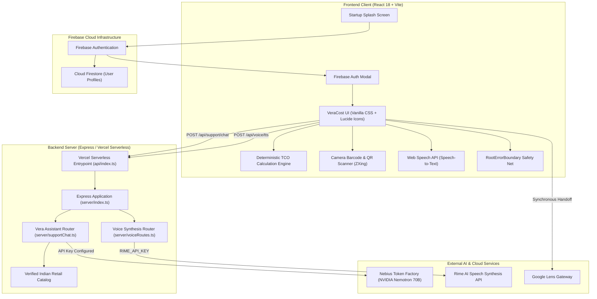

# VeraCost — AI-Assisted Total Cost of Ownership (TCO) & Shopping Decision Platform

[](LICENSE)
[](https://nodejs.org/)
[](https://react.dev/)
[](https://firebase.google.com/)
[](https://build.nvidia.com)
[](https://tokenfactory.nebius.com)
[]()
[]()

> **"Look beyond deceptive sticker prices. Uncover the true lifetime cost of ownership, recurring subscriptions, maintenance, accessories, operating power, and secondary-market resale recovery before buying."**

---

## 1. Project Overview

Consumers and procurement teams frequently fall into the **"Sticker Price Trap"**: purchasing products with attractive upfront discounts while remaining blind to massive downstream expenses—proprietary consumables, battery degradation, mandatory dongles/adapters, expensive protection plans, and rapid depreciation.

**VeraCost** is a full-stack, enterprise-grade decision platform and financial simulation engine that calculates the **True Total Cost of Ownership (TCO)** for consumer electronics, vehicles, appliances, and commercial hardware. It unifies verified multi-retailer price intelligence, visual barcode/QR scanning, clipboard screenshot ingestion, Firebase user authentication, and context-aware conversational AI into a unified, privacy-first interface.

### The Problem It Solves
- **Misleading Discount Pricing**: A ₹1,19,900 laptop often requires ₹12,000 in docks, adapters, and chargers not included in the box.
- **Hidden Consumable Traps**: A ₹1,500 inkjet printer or pod coffee machine can cost over ₹15,000 in recurring ink cartridges and pods over 3 years.
- **Fragmented Retail Research**: Comparing real checkout totals (taxes, shipping, bank discounts) across Amazon India, Flipkart, and Croma typically requires manual, error-prone tab switching.

---

## 2. Core Capabilities

### 🧮 Mathematical TCO Calculation Engine
- **Deterministic Modeling**: Strict mathematical normalization across multi-frequency billing (daily, weekly, monthly, quarterly, annual, one-time).
- **5-Dimension Cost Breakdown**:
  $$\text{TCO} = \text{Upfront Purchase} + \text{Setup \& Accessories} + \text{Recurring Subscriptions} + \text{Maintenance} + \text{Operating Energy} - \text{Resale Recovery}$$
- **Time-Horizon Trajectories**: Dynamic projection curves comparing 1-Year, 3-Year, and 5-Year ownership horizons with live SVG cumulative cash flow charts.
- **Scenario Stress-Testing**: Toggle between Typical, Lower-Cost, and Higher-Cost (aggressive maintenance & wear) scenarios.

### 🛍️ Smart Price Finder & Indian Retailer Integrations
- **Verified Indian Catalog**: Real-time pricing, MRP, model identifiers, and verified discounts for top electronics and appliances across **Amazon India, Flipkart, Croma, Reliance Digital, Vijay Sales, and Tata CLiQ**.
- **Checkout Cost Ranking**: Ranks merchant listings by **Estimated Checkout Cost** (Base Price + Mandatory Fees + Delivery − Applicable Bank Discounts).
- **Price History & Volatility**: Visualizes 6-month historical price fluctuations to identify all-time lows and optimal purchase timing.

### 📷 Visual Recognition & Hardware Scanning
- **Live Camera Barcode Scanner**: Browser-native webcam and mobile camera scanning powered by ZXing (`EAN-13`, `EAN-8`, `UPC-A`, `UPC-E`, `Code 128`, `Code 39`).
- **Product QR Code Scanner**: Live QR camera scanner decoding manufacturer SKU tags and direct e-commerce product links with automated domain safety validation.
- **Clipboard Screenshot Ingestion (<kbd>Ctrl+V</kbd>)**: Instant clipboard paste detection—capture any deal snippet with `Win+Shift+S` and paste directly into VeraCost without saving files to disk.
- **Multi-Object Visual Search**: Detects candidate products in complex multi-item photographs, filtering out human anatomical noise (hands, fingers) and UI clutter.
- **Google Lens Direct Handoff**: Synchronous handoff to Google Lens for public URLs, paired with an automated clipboard-copy bridge for local screenshot files.

### 🤖 Vera AI Assistant & Voice AI
- **Context-Aware Reasoning**: Conversational guide grounded in VeraCost's verified retail catalog. Tracks multi-turn dialogue, understands follow-up queries (*"How much is it at checkout?"*, *"Compare it with S24 Ultra"*), and provides actionable navigation shortcuts.
- **Voice Input (STT)**: Hands-free voice dictation powered by the browser-native Web Speech API, with real-time transcript editing.
- **Voice Output (TTS)**: High-fidelity natural voice audio synthesis served via server-side endpoints with complete Play, Pause, Resume, Replay, and Stop controls.
- **Zero Hallucination Policy**: If live pricing data is unavailable, Vera explicitly informs the user rather than inventing speculative prices or fake links.

### 🔐 Firebase Authentication & User Profiles
- **Branded Startup Experience**: Refined animated splash screen with ambient gradients and non-blocking initialization.
- **Secure Authentication**: Email & password authentication, display name, and optional phone number profile tracking.
- **Session Continuity**: Automatic session restoration on page reload.
- **Guest Explorer Mode**: Non-blocking preview mode allowing instant exploration without mandatory credential entry.
- **Top-Level Root Error Boundary**: Guards the application against unexpected client runtime exceptions, preventing silent black screens.

### 📬 Contact & Support Integration
- **Direct Gmail Web Compose**: Prepopulates an official support ticket draft addressed to `ronakbaidya83@gmail.com` with formatted user-agent diagnostics, issue description, steps to reproduce, and expected/actual outcomes.
- **Mailto & Phone Links**: Clickable `tel:+919051905871` telephone link and native mail client fallbacks.

---

## 3. Architecture Overview



---

## 4. Technology Stack

| Layer | Technologies | Purpose |
| :--- | :--- | :--- |
| **Frontend Core** | React 18, TypeScript 5.6, Vite 5.4 | High-performance reactive UI and instant HMR bundling |
| **Styling** | Vanilla CSS, CSS Custom Properties, Glassmorphism | Bespoke design system without heavy utility overhead |
| **Icons** | Lucide React | Clean, consistent SVG iconography |
| **Authentication** | Firebase SDK v11 (Auth + Firestore) | Secure user accounts, session tokens, and profiles |
| **Barcode / QR** | `@zxing/browser`, `@zxing/library` | Real-time multi-format video stream decoding |
| **Backend** | Express 4.21, Node.js (ES Modules), TSX | Server-side API routing and secret management |
| **AI Inference** | NVIDIA Nemotron 70B via Nebius Token Factory | Conversational reasoning, TCO audits, and executive summaries |
| **Voice AI** | Web Speech API (Input) + Rime TTS (Output) | Seamless bidirectional voice interaction |
| **Testing** | Vitest 2.1 | Automated unit and integration testing |
| **Hosting** | Vercel Serverless Functions | Edge CDN and scalable serverless execution |

---

## 5. Getting Started

### Prerequisites
- **Node.js**: v18.0.0 or higher (tested on Node v20 & v24)
- **npm**: v9.0.0 or higher

### Installation

```bash
# 1. Clone the repository
git clone https://github.com/RonakBairagi/VeraCost.git
cd VeraCost

# 2. Install dependencies
npm install

# 3. Create local environment file
cp .env.example .env
```

### Running Locally

To run both the Express backend API (`:3001`) and the Vite client (`:5173`) concurrently:

```bash
npm run dev
```

- **Frontend Client**: `http://localhost:5173`
- **Backend API**: `http://localhost:3001`
- **Health Check**: `http://localhost:3001/api/health`

Alternatively, you can run services independently:
```bash
# Run backend server only
npm run dev:server

# Run frontend client only
npm run dev:client
```

---

## 6. Environment Configuration

All sensitive secrets remain strictly on the server and are never committed to source control.

| Variable Name | Environment | Purpose | Required? |
| :--- | :---: | :--- | :---: |
| `PORT` | Server | Express server listening port (Default: `3001`) | No |
| `NEBIUS_API_KEY` | Server | Nebius Token Factory API key for NVIDIA Nemotron | Optional (Runs catalog reasoning engine if empty) |
| `NEBIUS_BASE_URL` | Server | Base URL for Nebius Token Factory | Optional |
| `NEBIUS_MODEL` | Server | Model ID: `nvidia/Llama-3.1-Nemotron-70B-Instruct-HF` | Optional |
| `RIME_API_KEY` | Server | Rime API key for Vera Assistant voice synthesis | Optional (Falls back to native browser speech) |
| `RIME_SPEAKER` | Server | Speaker voice ID (e.g., `celeste`, `astra`) | Optional |
| `RIME_MODEL` | Server | TTS model identifier (e.g., `coda`) | Optional |
| `VITE_FIREBASE_API_KEY` | Client (Vite) | Firebase Web API Key | Optional (Guest Mode active if empty) |
| `VITE_FIREBASE_AUTH_DOMAIN` | Client (Vite) | Firebase Auth Domain (`<project>.firebaseapp.com`) | Optional |
| `VITE_FIREBASE_PROJECT_ID` | Client (Vite) | Google Cloud / Firebase Project ID | Optional |
| `VITE_FIREBASE_STORAGE_BUCKET`| Client (Vite) | Cloud Storage Bucket URL | Optional |
| `VITE_FIREBASE_MESSAGING_SENDER_ID`| Client (Vite)| Firebase Cloud Messaging Sender ID | Optional |
| `VITE_FIREBASE_APP_ID` | Client (Vite) | Firebase Web Application ID | Optional |

> **Note**: Frontend variables must be prefixed with `VITE_` to be bundled by Vite. Server variables (`NEBIUS_API_KEY`, `RIME_API_KEY`) must never have the `VITE_` prefix to prevent browser bundle leakage.

---

## 7. Firebase Setup Guide

VeraCost uses Firebase Authentication (Email/Password) and optional Cloud Firestore for profile storage.

1. Open the [Firebase Console](https://console.firebase.google.com/) and create a project named **VeraCost**.
2. Navigate to **Build $\rightarrow$ Authentication $\rightarrow$ Sign-in method** and enable **Email/Password**.
3. Navigate to **Project Settings $\rightarrow$ General $\rightarrow$ Your apps** and click **Web App (`</>`)**.
4. Copy the `firebaseConfig` keys into your `.env` file using the `VITE_FIREBASE_` prefix:
   ```env
   VITE_FIREBASE_API_KEY=AIzaSy...
   VITE_FIREBASE_AUTH_DOMAIN=veracost-app.firebaseapp.com
   VITE_FIREBASE_PROJECT_ID=veracost-app
   VITE_FIREBASE_STORAGE_BUCKET=veracost-app.appspot.com
   VITE_FIREBASE_MESSAGING_SENDER_ID=1234567890
   VITE_FIREBASE_APP_ID=1:1234567890:web:...
   ```
5. *(Optional)* Navigate to **Build $\rightarrow$ Firestore Database** and click **Create Database**. Apply secure rules:
   ```javascript
   rules_version = '2';
   service cloud.firestore {
     match /databases/{database}/documents {
       match /users/{userId} {
         allow read, write: if request.auth != null && request.auth.uid == userId;
       }
     }
   }
   ```

---

## 8. AI Assistant & Voice Architecture

Vera Assistant operates on a hybrid architecture:

1. **User Inquiry**: Submitted via keyboard (`Enter` to send, `Shift+Enter` for multiline) or voice input (Web Speech API).
2. **Catalog Context Grounding**: `findProductsInQueryAndContext()` inspects the query and historical turns against `VERIFIED_INDIAN_CATALOG`. If a product or comparison is detected, verified live offers are appended to the system instructions.
3. **Inference Pipeline**:
   - If `NEBIUS_API_KEY` is active, the request is dispatched to `nvidia/Llama-3.1-Nemotron-70B-Instruct-HF` on Nebius Token Factory.
   - If unconfigured or offline, VeraCost’s deterministic Conversational Reasoning Engine produces a context-aware analysis without hallucinating prices.
4. **Voice Output (TTS)**:
   - Clicking the speaker button dispatches text to `/api/voice/tts`.
   - `cleanTextForSpeech` strips markdown, raw URLs, and formats currencies (`₹` $\rightarrow$ `Rs.`).
   - The server calls the configured TTS API and returns an `audio/mpeg` stream.
   - Audio is cached client-side per message ID to prevent redundant network requests.

---

## 9. Vercel Deployment

VeraCost is designed for frictionless deployment on Vercel:

1. **Git Push**:
   ```bash
   git push origin main
   ```
2. **Vercel Project Configuration**:
   - **Framework Preset**: `Vite`
   - **Build Command**: `npm run build` (`tsc && vite build`)
   - **Output Directory**: `dist`
3. **Environment Variables**:
   Add your server secrets (`NEBIUS_API_KEY`, `RIME_API_KEY`) and Firebase variables (`VITE_FIREBASE_...`) in **Vercel Settings $\rightarrow$ Environment Variables**.
4. **Serverless Routing**:
   `vercel.json` rewrites `/api/(.*)` to `/api?__path=$1` which routes directly to `api/index.ts`. The serverless entrypoint normalizes the request path so Express matches endpoints accurately.

---

## 10. Security & Privacy Safeguards

- **Zero Client Credential Leakage**: AI and TTS API keys are executed strictly on the Express backend and are excluded from the Vite browser bundle.
- **Root Error Boundary**: Unhandled component crashes render an actionable recovery screen rather than leaving users with a blank page.
- **Browser Privacy Guarantees**: Screenshot paste (<kbd>Ctrl+V</kbd>) operates entirely in memory using `FileReader`. VeraCost cannot observe operating system keystrokes or background windows.
- **Camera Stream Cleanup**: Webcam video tracks are terminated immediately upon closing the scanner modal, ensuring the hardware recording indicator turns off.
- **Honest Email Integration**: Preparing a draft in Gmail or mailto never displays a misleading "Email sent" confirmation.

---

## 11. Testing & Troubleshooting

### Running Automated Tests
```bash
npm test -- --run
```

VeraCost includes 56 automated unit and integration tests across 4 suites:
- `tests/calculator.test.ts` (14 tests): Multi-year TCO formulas, frequency normalization, scenario multipliers, replacement timing, and salvage recovery.
- `tests/shopping.test.ts` (11 tests): Retailer pricing, checkout cost ranking, search cleaning, and catalog matching.
- `tests/integration_and_ai.test.ts` (6 tests): AI prompt construction, payload sanitization, and fallback reasoning.
- `tests/support_and_scanner.test.ts` (25 tests): Barcode normalization, Gmail compose URL encoding, speech text sanitization, multi-turn assistant context, and Firebase error mapping.

### Common Troubleshooting

| Issue | Root Cause | Solution |
| :--- | :--- | :--- |
| **"Unable to connect to assistant service"** | Backend server is not running on port 3001 | Run `npm run dev` to launch both frontend and backend concurrently. |
| **Camera not opening on laptop** | Browser permissions blocked or non-secure context | Allow camera permissions in the address bar. Webcams require `https://` or `http://localhost`. |
| **Black screen on Vercel** | Server-side Node module imported into React components | Ensure no backend files (`server/*`) with Node built-ins are imported into `src/`. Verified clean with `npm run build`. |
| **Firebase "auth/invalid-api-key"** | Missing or invalid key in `.env` | Verify `VITE_FIREBASE_API_KEY` matches your Firebase console web app credentials. Use Guest Explorer mode if unconfigured. |

---

## 12. Contributing & License

Contributions are welcome! Please follow these guidelines:
1. Fork the repository and create a feature branch (`git checkout -b feature/amazing-feature`).
2. Run test suites to ensure zero regressions: `npm test -- --run`.
3. Verify production compilation: `npm run build`.
4. Submit a Pull Request with clear documentation of changes.

### License
This project is licensed under the **Apache License 2.0** — see the [LICENSE](LICENSE) file for complete details.

---

## 13. Project Status & Roadmap

- [x] Deterministic 5-dimension TCO Calculation Engine
- [x] Verified Indian Retailer Integration (Amazon, Flipkart, Croma, Reliance Digital, Vijay Sales)
- [x] Hardware Barcode (`EAN-13`/`UPC`) and Product QR Code live camera scanners
- [x] Clipboard Screenshot Import (<kbd>Ctrl+V</kbd>) and Google Lens handoff
- [x] Context-aware Vera Assistant with NVIDIA Nemotron 70B
- [x] Voice Input (Speech-to-Text) and Voice Output (TTS)
- [x] Branded Startup Loading Experience
- [x] Firebase Authentication (Email/Password + User Profile tracking)
- [x] Root Error Boundary & Vercel Serverless Architecture
- [ ] Multi-region currency live FX rates (USD, EUR, GBP, JPY live conversion)
- [ ] Push notifications for price alert thresholds
